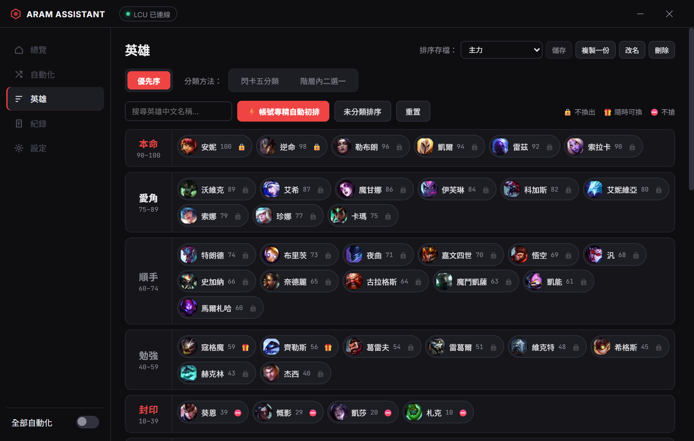

# ARAMPilot

《英雄聯盟》ARAM 與 ARAM: Mayhem 的選角助手（Windows）。只用客戶端在本機開放的官方 API，不讀遊戲記憶體、不模擬按鍵。

*A Windows champ-select assistant for League of Legends ARAM and ARAM: Mayhem. It only talks to the client's local API: no memory reading, no input simulation. The interface is in Traditional Chinese only.*



## 它會幫你做什麼

- 配對成功時自動接受。
- 開局標出英雄卡裡你最想玩的那隻，按一下就選；也可以打開自動選卡（預設關閉）。
- 板凳出現你更想玩的英雄時標出來，按一下就換；也可以打開自動搶板凳（預設關閉）。
- 隊友換角時依你的規則建議同意或拒絕，換完可以一鍵發一句話。
- 選角時的決定預設都由你按：App 只給建議。自動選卡和自動搶板凳要你自己打開才會動作。
- 自動帶召喚師技能，記住每隻英雄的副技能。
- 遊戲中到時間提醒你投降。
- 用分級、閃卡、二選一排出你的英雄優先序，可以存好幾份排序切換。

## 安全嗎？

- 選角階段只透過客戶端在本機開放的 LCU API（`127.0.0.1`）讀取狀態、送出接受／選角／換角請求。遊戲中只讀本機 Live Client Data（`127.0.0.1:2999`）的遊戲時間，用來提醒投降。
- 不注入、不讀遊戲記憶體、不模擬鍵盤或滑鼠。`/ff` 仍然要你自己打。
- 對外連線只有英雄頭像（CommunityDragon）和介面字型（Google Fonts），不會上傳任何資料。
- 第三方工具都有風險。Riot 沒有背書本工具，使用風險自負。

## 下載與安裝

到 [Releases](../../releases/latest) 下載 `ARAMPilot_<版本>_x64-setup.exe`，執行後照畫面安裝。

- 需求：Windows 10／11，需要 WebView2（Windows 11 內建）。
- 不需要管理員權限，只裝在你自己的使用者帳號底下。
- 安裝檔沒有程式碼簽章，Windows SmartScreen 會跳出「Windows 已保護您的電腦」：按「其他資訊 → 仍要執行」。
- 想自己編譯，見下方「開發」。

### 更新

App 啟動時會自動檢查新版，也可以在「設定 → 版本與更新」手動檢查。有新版時按「立即更新」，App 會自己下載、安裝並重新開啟，設定和排序都會保留。更新檔有簽章，簽章不符時不會安裝。

## 使用方式

1. 開英雄聯盟客戶端和 ARAMPilot（先開哪個都可以），左上角顯示「LCU 已連線」。
2. 到「英雄」頁排優先序：可以先按「帳號專精自動初排」排出第一版，再用「閃卡五分類」「階層內二選一」微調，最後按右上的「儲存」。
3. 到「自動化」頁打開你要的功能。左下角「全部自動化」是總開關。
4. 開始排隊。關掉視窗後會縮到系統匣繼續運作。

## 功能

### 選角前

| 功能 | 說明 |
|---|---|
| 自動接受對戰 | 延遲可調（0.1 秒刻度）；可選生效模式（ARAM／Mayhem／其他）與提醒方式（靜音／提示音／系統通知） |
| 開局選卡建議 | 標出建議的卡，按「選這張」才選；策略：最高分，或只選本命／愛角。可另外開啟「自動選建議的卡」（預設關閉），延遲後自動選，你先手動選了就不覆蓋 |
| 板凳建議 | 分差達門檻時標出建議的英雄，按「建議換」才換；🔒 標記的英雄不建議換出。可另外開啟「自動換成建議英雄」（預設關閉），會等英雄上板凳滿 3 秒才換，和官方客戶端一樣 |
| 隊友換角建議 | 依分差建議同意或拒絕，由你按；可設絕不換出的階層；組排好友可另設規則 |
| 換角發話建議 | 換角成功後顯示「發送」按鈕，按了才送；模板可自訂，支援 `{old}`／`{new}` |
| 召喚師技能 | 閃現放 D 或 F、預設副技能；選角時點過的副技能會記在該英雄 |
| 規則試算 | 調整分差與隊友身分，即時預覽換角判定 |
| 自訂房測試 | 開 1 人自訂大亂鬥試跑選角自動化（一般大廳與正式對戰不會觸發） |

### 英雄排序

| 功能 | 說明 |
|---|---|
| 優先序 | 本命／愛角／順手／勉強／封印五個階層，拖曳排序、搜尋；🔒 不換出、🎁 隨時可換、⛔ 不搶 |
| 帳號專精自動初排 | 依帳號英雄專精分數排出第一版 |
| 閃卡五分類 | 一隻一隻看，按 1–5 分到階層 |
| 階層內二選一 | 同階層兩兩比較調出順位；投票先記在草稿，套用前會預覽變動並自動備份，可以復原 |
| 排序存檔 | 存好幾份排序（順序、階層、標記、二選一權重）並切換；按「儲存」才寫進目前存檔，可「還原」；「複製一份」從目前排序開新存檔 |

### 遊戲中

| 功能 | 說明 |
|---|---|
| 投降提醒 | 到設定時間提醒：複製 `/ff`、提示音或桌面通知（Riot 會擋外部貼上，仍要你自己輸入） |

### 其他

- 總覽：對戰進度、目前英雄、板凳（依權重排序，可手動搶角）、最近一筆紀錄。
- 紀錄：所有自動化事件，可篩選已執行／略過／錯誤。
- 系統匣：各項自動化開關、開啟主視窗、重新啟動、結束程式。再次執行程式會叫回原本的視窗，不會開第二份。
- 設定：強調色、關閉到系統匣、開機自啟、客戶端關閉時的行為、匯出／匯入 JSON。

## 資料存在哪裡

全部在 `%APPDATA%\ARAMPilot\`，只存在這台電腦：

| 檔案 | 內容 |
|---|---|
| `config.json` | 設定與英雄排序（一台電腦一份，不分 LoL 帳號） |
| `backups\` | 批次修改前的自動備份（保留最新 20 份） |
| `exec-log.jsonl` | 執行紀錄（超過 2 MB 會輪替） |

- 換電腦：「設定 → 匯出 JSON」，到新電腦匯入。
- 設定檔壞掉時會另存成 `*.corrupt-<時間>.json`；暫時讀不到（例如被防毒鎖住）時會關掉自動化並暫停存檔。兩種情況都不會用預設值蓋掉你的設定。
- 移除程式後想清乾淨，刪掉這個資料夾。開機自啟會在 `HKCU\Software\Microsoft\Windows\CurrentVersion\Run` 寫一個值，關掉開關就會刪除。

## 常見問題

**會被封鎖嗎？**
沒有人能保證。ARAMPilot 不碰遊戲本體，只用客戶端開給本機的 API，跟常見的客戶端輔助工具同一類。請自行評估風險。

**支援哪些模式？**
選角自動化只在 ARAM（一般、衝突賽、人機、自訂）與 ARAM: Mayhem 作用。自動接受對戰可以另外勾選其他模式。

**我有好幾個帳號？**
設定跟著電腦走，不分帳號。想為不同帳號或玩法分開排，用「排序存檔」切換。

## 開發

需要 Node.js、pnpm、Rust（stable）與 [Tauri v2 的 Windows 前置需求](https://v2.tauri.app/start/prerequisites/)。

```powershell
pnpm install
pnpm tauri dev                                  # 開發模式
pnpm test                                       # 前端單元測試（vitest）
cargo test --manifest-path src-tauri/Cargo.toml # 後端測試
pnpm tauri build                                # 產生安裝檔
```

| 路徑 | 內容 |
|---|---|
| `src-tauri/src/lcu.rs` | 找到客戶端、連線 LCU（HTTPS＋WebSocket）、各 API 呼叫 |
| `src-tauri/src/engine.rs` | 選卡、搶板凳、換角的判定規則 |
| `src-tauri/src/config.rs` | 設定讀寫、備份、開機自啟 |
| `src-tauri/src/livegame.rs` | 遊戲中投降提醒 |
| `src-tauri/src/lib.rs` | Tauri 指令、事件、系統匣 |
| `src/main.ts` | 介面與互動；其餘 `src/*.ts` 是可單獨測試的純邏輯 |
| `mockups/algo-lab.html` | 排序工作台（網頁版排序工具，搭配 `mockups/autosave_server.py`） |

給程式 agent 的規則在 [AGENTS.md](AGENTS.md)。

## 免責聲明

ARAMPilot isn't endorsed by Riot Games and doesn't reflect the views or opinions of Riot Games or anyone officially involved in producing or managing Riot Games properties. Riot Games, and all associated properties are trademarks or registered trademarks of Riot Games, Inc.

英雄頭像來自 [CommunityDragon](https://www.communitydragon.org/)。

## 授權

[MIT](LICENSE)
